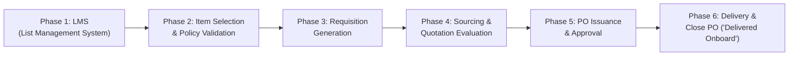

# Standard Operating Procedure (SOP): Creating and Closing a Procurement Order in JiBe ERP

---

## 1. Executive Summary & Procurement Lifecycle Overview

In maritime vessel management using **JiBe ERP**, procurement follows a structured, multi-stage workflow designed to enforce budgeting controls, segregation of duties, departmental segmentation, and strict audit compliance. 

The end-to-end lifecycle consists of six core phases:

---

## 2. Phase-by-Phase Execution Guide

### Phase 1: User Identity & Initiating an Item List in LMS
1. **User Onboarding & Session Identity:**
   - Upon initial arrival, the user is prompted with *"What should we call you?"* to enter their active training username.
   - The username is stored in client memory and dynamically injected into the top navigation bar, the LMS table "Created By" audit column, and discussion logs (replacing generic placeholder "Ivan Xavier" and initials "IX").
2. **Access LMS:**
   - On the top navigation bar, hover over **Procurement** and select **Lists** (LMS).
   - URL path: `procurement/item-list-main-page` (`page2.html`).
3. **Create New List:**
   - Click the **"+ Create New"** button in the top-right corner.
   - Complete the mandatory list header fields:
     - **Vessel:** Select the target vessel (e.g., `SESP Demo Vessel`).
     - **List Name:** Enter a descriptive name (e.g., `Chemicals Requisition - Deck & Engine`).
     - **Urgency:** Assign priority (e.g., `D: Regular Spares/Stores`, `Emergency`, `Urgent`).
     - **Vessel Department:** Assign owner department (e.g., `Engine`, `Deck`, `Catering`).
   - Click **Create**. A unique List ID is generated (format: `LIST SPDM-XXXXX/YY`).
   - *Draft Discard Rule:* Navigating directly back to the landing page (`page1.html`) automatically discards in-progress draft list data while preserving the user's identity.

---

### Phase 2: Metadata, Checklists, and Item Selection

#### A. Metadata & Checklists
1. **Tags:** Select applicable regulatory or operational tags (e.g., `MARPOL`, `Anti-Piracy Good`, `Critical Spares`).
2. **General Remarks:** Document internal operational notes (flagged as `Internal use ONLY`).
3. **Checklist:**
   - Click **Edit** in the Checklist section.
   - Add verification steps (e.g., *"Verify remaining onboard stock"*, *"Check SDS safety compliance"*).
   - Click **Save**.
4. **Attachments:** Attach relevant drawings, surveys, or damage reports if required.

#### B. Adding Items from Catalogues
1. Navigate to the **Items** tab and click **Browse Item**.
2. Select the catalogue segment (e.g., `Chemicals`, `Spares`, `Stores`).
3. Drill down into the supplier/equipment categories:
   - Example: *A&T Upgrades > List of HydroDynamic Upgrades > Envirologic HF HP 32*.
   - Example: *Chemicals > Drew Marine > Aux Engine Cleaners*.
4. Specify requested quantities and click **Add to List**.

#### C. Understanding the Segment Restriction Policy
> [!IMPORTANT]
> **Strict Segment Isolation Rule:**
> JiBe enforces procurement segmentation policies to prevent incompatible item types from being grouped together on a single requisition.
> 
> Allowed segment groupings:
> - `["Spares", "Services"]`
> - `["Chemicals"]`
> - `["High Value Stores & Equipment"]`
> - `["IT Office Spares & Services"]`
> - `["Shipboard IT Equipment & Services"]`
> - `["Stores"]`
> - `["Logistics"]`
> 
> *Violation Example:* Attempting to add a **Service finding / job** to a list that already contains **Chemical items** will trigger a validation block:
> *"Adding this item violates the allowed segments policy and is therefore restricted."*

---

### Phase 3: Constructing the Requisition & Button State Lifecycle

1. **Button Lifecycle Rules:**
   - **Save List Button:** Disabled by default on arrival (`#dbe3ec`). Transitions to active blue (`#1a73e8`) upon any list modification (Tag selection, Remarks entry, Checklist creation, or Attachment upload). Reverts to disabled state upon clicking Save.
   - **Create Requisition Button:** Remains disabled until line items are added from the Items section (`lms_items_list.length > 0`).
2. **Requisition Parameter Configuration:**
   - Click **"Create Requisition"** in the top navigation bar.
   - **Purchase Type:** Select segment-aligned purchase type (e.g., `High Value Stores`, `Chemicals`, `Spares`).
   - **Delivery Port:** Search and select the target port call (e.g., `Pasir Panjang / Singapore`, `Rotterdam`).
   - **Delivery Date:** Select the target delivery date according to vessel ETA.
   - **Subject:** Enter a clear requisition summary line (e.g., *"Chemicals for deck and engine"*).
3. **Two-Stage Confirmation & Permanent Locking:**
   - Click **Save** in the requisition modal to open the confirmation dialog (*"Are you sure you want to create a requisition?"*).
   - Click **Confirm**:
     - System constructs Requisition `SPDM-60037/26` with cyan success dialog.
     - Discussion Feed logs the creation under the active user's name and avatar initials.
     - LMS List status automatically updates to **Completed** (both on Page 3 and synchronized to Page 2).
     - **BOTH "Save List" and "Create Requisition" buttons permanently lock into disabled state** to prevent post-completion modifications.

---

### Phase 4: Supplier Sourcing & Quotation Evaluation (Office Workflow)

1. Navigate to **Procurement > Procurement Main**.
2. Locate the new requisition under the **New Requisition** queue or filter by `Type: Requisition`.
3. Open the Requisition:
   - Review line items and quantities.
   - Click **Source Suppliers** to send RFQs (Request for Quotations) to approved marine vendors.
4. Compare quotes in the **Quotation Evaluation** tab:
   - Review pricing, currency exchange rates, freight charges, lead times, and port delivery terms.
   - Select the winning bid and approve the commercial terms.

---

### Phase 5: Generating and Issuing the Purchase Order (PO)

1. Upon quotation approval, generate the Purchase Order (format: `SDV3-XXXXX/YY-1`).
2. The PO contains:
   - Detailed Pricing Summary: Sub-Total, Taxes, Freight Cost, Handling Charges.
   - Delivery Instructions: Delivery Agent, Port ETA, Packing requirements.
3. Authorization & PO Release:
   - Internal PO approval workflow runs according to company authority matrix.
   - Once approved, the PO status transitions to **PO Issued** / **Pending Supplier Confirmation**.
   - Upon supplier acknowledgement, the status updates to **Pending Delivery**.

---

### Phase 6: Delivery Verification & Closing the PO ("Delivered Onboard")

1. **Vessel Receipt & Inspection:**
   - When the shipment arrives alongside the vessel at the designated port:
   - The Chief Engineer / Chief Officer inspects the delivered items against the PO delivery note and packing slips.
2. **Accessing the PO in JiBe:**
   - Navigate to **Procurement Main > Purchase Orders**.
   - Filter by `Type: PO` or search the PO reference.
   - Select the PO in `Pending Delivery` status.
3. **Closing the Purchase Order:**
   - Verify line items, delivered quantities, and delivery records.
   - Click the **"Delivered Onboard"** button on the top right.
   - Record delivery details:
     - Delivery date & port.
     - Quantity accepted / notes on discrepancies or damaged goods.
     - Upload stamped Delivery Order (DO) / Bunker/Chemical delivery note.
   - Confirm receipt: The PO status updates to **Delivered Onboard / Closed**, concluding the procurement lifecycle and triggering invoice reconciliation in Finance.

---

## 3. Summary of Key Status Transitions

| Stage | Document | Typical Statuses | Key Action to Progress |
|---|---|---|---|
| **1. LMS** | List (`LIST SPDM-...`) | `Active` → `Completed` | Click **Create Requisition** |
| **2. Requisition** | Req (`SPDM-...`) | `New Requisition` → `Quotation` → `Approved` | Click **Source Suppliers** & Evaluate RFQ |
| **3. Purchase Order** | PO (`SDV3-...`) | `PO Created` → `PO Approved` → `Pending Delivery` | Supplier acknowledgment & dispatch |
| **4. Fulfillment** | PO (`SDV3-...`) | `Pending Delivery` → `Delivered Onboard` (Closed) | Click **Delivered Onboard** upon physical receipt |

---

## 4. Best Practices Checklist for Vessel & Office Teams

- [x] **Match Segments Before Adding Items:** Keep stores, chemicals, spares, and drydock services in independent lists.
- [x] **Accurate ETA & Port Call Selection:** Align delivery dates with official vessel schedules to prevent port storage demurrage.
- [x] **Audit Checklists:** Use LMS checklists for mandatory technical checks (e.g., verifying serial numbers or hazardous material permits).
- [x] **Timely PO Closure:** Ensure vessel crew clicks **Delivered Onboard** immediately upon physical receipt to avoid delayed supplier invoice settlements.
