# JiBe ERP Simulator — Project Flow Chart
## Complete Step-by-Step Workflow from Page 1 to Page 4

This document defines the exact end-to-end user interaction sequence across the JiBe ERP dummy training website (`page1.html` through `page4.html`). Every click, selection, text input, modal popup, variable persistence mechanism, discard rule, button state lifecycle, and screen transition has been compiled directly and exclusively from the user prompts provided during the project implementation.

---

## 1. High-Level Process Architecture

```mermaid
flowchart TD
    P1["PAGE 1: Dashboard\n(Landing Page — Prompts: 'What should we call you?')"] -->|Hover 'Procurement' & Click 'Lists'| P2["PAGE 2: Lists Table\n(LMS Grid & + Create New)"]
    
    P2 -->|Direct Nav to Landing Page\n(Discard Draft Data)| P1
    
    P2 -->|Select Vessel, Name, Urgency, Dept\nClick 'Create' (02-10-2026)| P3_DETAILS["PAGE 3: List Details\n(Header: Save List & Create Requisition Buttons Disabled by Default)"]
    
    P3_DETAILS -->|Direct Nav to Landing Page\n(Discard Draft Data)| P1
    
    P3_DETAILS -->|User Modifies Remarks/Tag/Checklist/Attachments\n'Save List' Button Becomes Enabled| P3_SAVE["PAGE 3: List Details (Dirty State)\n('Save List' Button Enabled)"]
    
    P3_SAVE -->|Click 'Save List' button\n(Commits list; 'Save List' Reverts to Disabled State)| P3_DETAILS
    
    P3_DETAILS -->|Click Left Menu 'Items'| P3_ITEMS["PAGE 3: Items Table View\n(Items, Services, Machinery)"]
    
    P3_ITEMS -->|Click 'Browse Item'| P4_CHEMICALS["PAGE 4: Browse Items\n(Segment: Chemicals, Dynamic Active List Name)"]
    
    P4_CHEMICALS -->|Add Items 1-3 to List\nClick 'Back to List'| P3_ITEMS2["PAGE 3: Updated Items List\n(Reflects 3 Added Items; 'Create Requisition' Button Enables)"]
    
    P3_ITEMS2 -->|Click 'Browse Services' (Optional)| P4_SERVICES["PAGE 4: Browse Services\n(Bridge Item -> Segment Policy Error Popup)"]
    
    P4_SERVICES -->|Click 'Back to List'| P3_ITEMS3["PAGE 3: Verified List\n(Machinery Section Permanent; 'Create Requisition' Enabled)"]
    
    P3_ITEMS3 -->|Click 'Create Requisition'| REQ_MODAL["Create Requisition Modal\n(Port Call, Purchase Type, Delivery Port, Calendar Date, Subject)"]
    
    P3_ITEMS3 -->|Click 'Save'| REQ_CONFIRM["Confirmation Popup\n('Are you sure you want to create a requisition?')"]
    
    REQ_MODAL -->|Click 'Save'| REQ_CONFIRM
    
    REQ_CONFIRM -->|Click 'Confirm'| REQ_SUCCESS["New Requisition Dialog\n(Cyan Text: 'Requisition SPDM-60037/26 created successfully')"]
    
    REQ_SUCCESS -->|Click 'Close' or 'Open Link'| P3_COMPLETE["PAGE 3: Completed Workflow\n(Status: Completed; BOTH 'Create Requisition' & 'Save List' Permanently Disabled)"]

    style P1 fill:#1e293b,stroke:#3b82f6,stroke-width:2px,color:#fff
    style P2 fill:#1e293b,stroke:#3b82f6,stroke-width:2px,color:#fff
    style P3_DETAILS fill:#1e293b,stroke:#3b82f6,stroke-width:2px,color:#fff
    style P3_SAVE fill:#1e3a8a,stroke:#3b82f6,stroke-width:2px,color:#fff
    style P3_ITEMS fill:#1e293b,stroke:#3b82f6,stroke-width:2px,color:#fff
    style P4_CHEMICALS fill:#0f766e,stroke:#14b8a6,stroke-width:2px,color:#fff
    style P3_ITEMS2 fill:#1e293b,stroke:#3b82f6,stroke-width:2px,color:#fff
    style P4_SERVICES fill:#b91c1c,stroke:#ef4444,stroke-width:2px,color:#fff
    style P3_ITEMS3 fill:#1e293b,stroke:#3b82f6,stroke-width:2px,color:#fff
    style REQ_MODAL fill:#1e3a8a,stroke:#60a5fa,stroke-width:2px,color:#fff
    style REQ_CONFIRM fill:#d97706,stroke:#fbbf24,stroke-width:2px,color:#fff
    style REQ_SUCCESS fill:#047857,stroke:#10b981,stroke-width:2px,color:#fff
    style P3_COMPLETE fill:#1e293b,stroke:#a855f7,stroke-width:2px,color:#fff
```

---

## 2. Granular Step-by-Step Flow Chart (Action by Action)

```mermaid
flowchart TD
    subgraph PHASE1["Phase 1: Page 1 - Landing Page & Onboarding Prompt (page1.html)"]
        S0A["Step 1a: User lands on site -> 'What should we call you?' Modal Pops Up\n(Prompt with User icon, Username input & Proceed button)"]
        S0A --> S0B["Step 1b: User inputs Username & clicks 'Proceed'\n(Saved dynamically into variable 'jibe_username' & 'jibe_user_initials')"]
        S0B --> S0C["Step 1c: Dynamic Identity Sync\n(Replaces 'Ivan Xavier' & 'IX' globally across all pages and tables)"]
        S0C --> S1["Step 1: User views page1.html Dashboard\n(Header displays custom username; click profile to edit)"]
        S1 --> S2["Step 2: Hover over 'Procurement' in Top Navbar\n(Active highlight moves from Technical to Procurement)"]
        S2 --> S3["Step 3: Click 'Procurement' Nav Item"]
        S3 --> S4["Step 4: Dropdown Menu Opens\n('Lists' is highlighted)"]
        S4 --> S5["Step 5: Click 'Lists' in Dropdown"]
        S5 --> S6["Step 6: Navigate to page2.html"]
    end

    subgraph PHASE2["Phase 2: Page 2 - LMS Lists Table & New List Creation (page2.html)"]
        S6 --> S7["Step 7: View LMS Table\n(Table records; list name & status color #2f79bb)"]
        S7 --> S8["Step 8: Click '+ Create New' Button in Top Right"]
        S8 --> S9["Step 9: 'Create New List' Modal Dialog Opens"]
        S9 --> S10["Step 10: Select Vessel: 'SESP Demo Vessel'\n(Saved dynamically into variable for cross-page persistence)"]
        S10 --> S11["Step 11: Enter List Name\n(Saved dynamically into variable for cross-page persistence)"]
        S11 --> S12["Step 12: Select Urgency: 'D-Regular Spares/Stores'\n(Saved dynamically into variable for cross-page persistence)"]
        S12 --> S13["Step 13: Select Vessel Department: 'Engine'\n(Saved dynamically into variable for cross-page persistence)"]
        S13 --> S14["Step 14: Click 'Create' Button in Modal"]
        S14 --> S15["Step 15: Capture Creation Date (02-10-2026) & Navigate to page3.html"]
        
        DISCARD_RULE_P2["Rule: If user goes directly to Landing page (page1.html) from here,\nin-progress list data is automatically discarded."]
    end

    subgraph PHASE3["Phase 3: Page 3 - List Details Configuration (page3.html)"]
        S15 --> S16["Step 16: View List Details Page\n(Header title dynamically displays List Name from variable;\n'Save List' button is DISABLED by default;\n'Create Requisition' button is DISABLED until items are added)"]
        S16 --> S17["Step 17: Click 'Tags' Box under General Information"]
        S17 --> S18["Step 18: General Remarks Expands Rich Text Editor (2500-char limit)"]
        S18 --> S19["Step 19: Select 'MARPOL' Tag from Dropdown\n('Save List' button TRANSITIONS TO ENABLED)"]
        S19 --> S20["Step 20: Scroll to Checklist Card -> Click 'Edit' Button"]
        S20 --> S21["Step 21: Edit Action Bar Appears ('Discard Changes' & 'Save')"]
        S21 --> S22["Step 22: Click 'Add checklist item' Button"]
        S22 --> S23["Step 23: Type Item Text\n('Save List' button remains ENABLED)"]
        S23 --> S24["Step 24: Click 'Save' (or 'Discard Changes')\n(Saved dynamically into variable for cross-page persistence)"]
        S24 --> S25["Step 25: Scroll to Attachments Card -> Click 'Attach File' Button"]
        S25 --> S26["Step 26: Upload Modal Dialog Pops Up"]
        S26 --> S27["Step 27: Click 'Browse' Button & Select Local File"]
        S27 --> S28["Step 28: Enter Remarks in 'Attachment Remarks' Textarea"]
        S28 --> S29["Step 29: Click 'Upload' Button\n(File attached; 'Save List' button remains ENABLED)"]
        S29 --> S30["Step 30: File Appears in Attachments Table & Modal Closes"]
        S30 --> S31["Step 31: Click 'Save List' Button (#btn-save-list)"]
        S31 --> S32["Step 32: Green Success Toast Displays: 'ItemList saved successfully.'\n('Save List' button REVERTS TO DISABLED STATE unless further changes are made)"]
        
        DISCARD_RULE_P3["Rule: If user goes directly back to page 1 from here,\nin-progress list data is automatically discarded."]
    end

    subgraph PHASE4["Phase 4: Left Menu & Navigation to Browse Items"]
        S32 --> S33["Step 33: Click 'Items' in Left Sidebar Menu"]
        S33 --> S34["Step 34: Expands Sub-options: Items, Services, Machinery"]
        S34 --> S35["Step 35: View Switches to Items Subdivision on page3.html"]
        S35 --> S36["Step 36: Click 'Browse Item' Button in Items Header"]
        S36 --> S37["Step 37: Navigate to page4.html"]
    end

    subgraph PHASE5["Phase 5: Page 4 - Catalogues & Adding Chemicals (page4.html)"]
        S37 --> S38["Step 38: Verify Active List Name reflects Variable from Page 2"]
        S38 --> S39["Step 39: Click 'Select Segment' Dropdown"]
        S39 --> S40["Step 40: Select 'Chemicals' Option"]
        S40 --> S41["Step 41: Category Tree Updates; Table Shows 'No Records Found'"]
        S41 --> S42["Step 42: Click 'A&T Upgrades' in Tree -> Click 'EnviroLogic...' Item"]
        S42 --> S43["Step 43: Item Drawer Expands -> Click 'Add to list' Button"]
        S43 --> S44["Step 44: Blue Toast Displays: 'Item Added to List'\n(Saved dynamically into variable for cross-page persistence)"]
        S44 --> S45["Step 45: Click 'Chemicals' under Active GL2 in Tree -> Click 'Test UAT' Item"]
        S45 --> S46["Step 46: Item Drawer Expands -> Click 'Add to list' Button"]
        S46 --> S47["Step 47: Blue Toast Displays: 'Item Added to List'\n(Saved dynamically into variable for cross-page persistence)"]
        S47 --> S48["Step 48: Click 'Demo Catalogue' in Tree -> Click 'DCSI003' Item"]
        S48 --> S49["Step 49: Item Drawer Expands -> Click 'Add to list' Button"]
        S49 --> S50["Step 50: Blue Toast Displays: 'Item Added to List'\n(Saved dynamically into variable for cross-page persistence)"]
        S50 --> S51["Step 51: Click 'Back to List' (Upper Left Corner) to return to page3.html\n(Saves this list on page 2 with 3 items & segment 'Chemicals')"]
    end

    subgraph PHASE6["Phase 6: Services Policy Check & Machinery Verification (page3.html <-> page4.html)"]
        S51 --> S52["Step 52: page3.html Items Table Reflects Items Selected from page 4 (3 Items)\n('Create Requisition' button BECOMES ENABLED)"]
        S52 --> S53["Step 53: Verify Machinery Section is Permanently Embedded under Services"]
        S53 --> S54["Step 54 (Optional): Click 'Browse Services' Button -> Opens page4.html in Services Mode"]
        S54 --> S55["Step 55 (Optional): Click 'Bridge' under 'SESP Demo Vessel' -> Click Service Item"]
        S55 --> S56["Step 56 (Optional): Click 'Add to list' Button"]
        S56 --> S57["Step 57 (Optional): Segment Policy Error Popup Triggers\n(Services cannot be mixed with Chemicals)"]
        S57 --> S58["Step 58: Click 'Back to List' to return to page3.html\n(Saves this list on page 2; 'Create Requisition' button remains enabled)"]
    end

    subgraph PHASE7["Phase 7: Create Requisition Parameters (page3.html)"]
        S58 --> S59["Step 59: Click 'Create Requisition' Button (#btn-create-req)"]
        S59 --> S60["Step 60: Modal Initializes with Vessel, Urgency, and Pre-filled Subject"]
        S60 --> S61["Step 61: Select Port Call (e.g., SESP-PC-2026-001 (Singapore))"]
        S61 --> S62["Step 62: Click 'Purchase Type *' -> Select 'High Value Stores'"]
        S62 --> S63["Step 63: Click 'Delivery Port *' -> Ports Modal Opens (14,664 records)"]
        S63 --> S64["Step 64: Search 'Singapore' -> Select 'Pasir Panjang' -> Click 'Confirm'"]
        S64 --> S65["Step 65: Ports Modal Closes -> Field Populated with 'Pasir Panjang | Singapore'"]
        S65 --> S66["Step 66: Click 'Delivery Date *' -> Calendar Popover Opens (October 2026)"]
        S66 --> S67["Step 67: Click Day 2 (02-10-2026) -> Popover Closes"]
        S67 --> S68["Step 68: Enter/edit Subject: 'Chemicals for deck and eng'"]
        S68 --> S69["Step 69: Form Validates -> 'Save' Button Turns Solid Blue"]
    end

    subgraph PHASE8["Phase 8: Confirmation & Requisition Creation Popups (page3.html)"]
        S69 --> S70["Step 70: Click 'Save' Button (#btn-req-save)"]
        S70 --> S71["Step 71: Confirmation Dialog Appears:\n'Are you sure you want to create a requisition?' with Cancel and Confirm"]
        S71 --> S72["Step 72: Click 'Confirm' Button"]
        S72 --> S73["Step 73: Confirmation Dialog Vanishes and New Requisition Dialog Appears"]
        S73 --> S74["Step 74: Dialog Displays Cyan Message:\n'Requisition SPDM-60037/26 has been created successfully'"]
        S74 --> S75["Step 75: LMS List Status Updates to 'Completed' and Discussion Feed Logs the Event\n(BOTH 'Create Requisition' & 'Save List' Buttons PERMANENTLY DISABLED)"]
        S75 --> S76["Step 76: Click 'Close' or 'Open Link' Button"]
        S76 --> S77["Step 77: Dialogs Close with Final Success Toast"]
    end

    PHASE1 --> PHASE2
    PHASE2 --> PHASE3
    PHASE3 --> PHASE4
    PHASE4 --> PHASE5
    PHASE5 --> PHASE6
    PHASE6 --> PHASE7
    PHASE7 --> PHASE8
```



---

## 3. Comprehensive Step Sequence Table

| Step # | Page / Location | UI Element / Target | Action Type | Input / Selected Value | Result / System Response |
| :---: | :--- | :--- | :---: | :--- | :--- |
| **1a** | `page1.html` | Onboarding Modal | View | Prompt dialog | Modal prompts *"What should we call you?"* with person icon, input, and `Proceed` button. |
| **1b** | `page1.html` | Onboarding Modal | Input & Click | Type Username + click `Proceed` | Saves username & initials into dynamic persistent variable (`jibe_username`); modal closes. |
| **1c** | All Pages | Global Identity | Dynamic Update | User profile & tables | Dynamically replaces *"Ivan Xavier"* with custom username and *"IX"* with initials across site. |
| **1** | `page1.html` | Top Navbar | Hover | `Procurement` menu item | Nav highlight moves to Procurement. |
| **2** | `page1.html` | Top Navbar | Click | `Procurement` menu item | Dropdown menu opens with "Lists" highlighted. |
| **3** | `page1.html` | Procurement Dropdown | Click | `Lists` option | Browser navigates to `page2.html`. |
| **4** | `page2.html` | LMS Lists Table | View | Table records | Non-clickable rows; List Name & Status colored `#2f79bb`. |
| **5** | `page2.html` | Header Actions | Click | `+ Create New` button | Opens "Create New List" modal dialog in top right. |
| **6** | `page2.html` | Create Modal | Select | Vessel: `SESP Demo Vessel` | Saved dynamically into variable for cross-page persistence. |
| **7** | `page2.html` | Create Modal | Input | Enter List Name | Saved dynamically into variable for cross-page persistence. |
| **8** | `page2.html` | Create Modal | Select | Urgency: `D-Regular Spares/Stores` | Saved dynamically into variable for cross-page persistence. |
| **9** | `page2.html` | Create Modal | Select | Vessel Department: `Engine` | Saved dynamically into variable for cross-page persistence. |
| **10** | `page2.html` | Create Modal | Click | `Create` button | Captures creation date (`02-10-2026`) and navigates to `page3.html`. |
| **--** | `page2.html` | Header / Logo | Direct Nav | Navigate to `page1.html` | **Discard Rule**: In-progress list data is automatically discarded. |
| **11** | `page3.html` | Header Title | View | Dynamic list title | Dynamically displays List Name from variable. |
| **12** | `page3.html` | Top Header Actions | View | `Save List` & `Create Requisition` buttons | **Both buttons are DISABLED by default** on initial arrival. |
| **13** | `page3.html` | General Info Card | Click | `Tags` box | General Remarks expands rich text editor (2,500-char limit). |
| **14** | `page3.html` | Tags Dropdown | Click | `MARPOL` tag | MARPOL tag selected; **`Save List` button becomes ENABLED (active)**. |
| **15** | `page3.html` | Checklist Card | Click | `Edit` button | Action bar toggles with "Discard Changes" and "Save". |
| **16** | `page3.html` | Checklist Card | Click | `Add checklist item` | Opens editable row. |
| **17** | `page3.html` | Checklist Card | Input | Type item text | Checklist item entered. |
| **18** | `page3.html` | Checklist Card | Click | `Save` (or `Discard Changes`) | Checklist saved; `Save List` button remains enabled. |
| **19** | `page3.html` | Attachments Card | Click | `Attach File` button | Opens Upload Modal dialog. |
| **20** | `page3.html` | Upload Modal | Click | `Browse` button | Local file selection triggered. |
| **21** | `page3.html` | Upload Modal | Input | Enter remarks | Remarks entered into attachment remarks textarea. |
| **22** | `page3.html` | Upload Modal | Click | `Upload` button | Attachment saved; modal closes; `Save List` remains enabled. |
| **23** | `page3.html` | Top Header Actions | Click | `Save List` button (#btn-save-list) | Green success toast displays; **`Save List` reverts to DISABLED state**. |
| **--** | `page3.html` | Header / Logo | Direct Nav | Navigate back to `page1.html` | **Discard Rule**: In-progress list data is automatically discarded. |
| **24** | `page3.html` | Left Sidebar | Click | `Items` menu section | Expands sub-options: `Items`, `Services`, `Machinery`. |
| **25** | `page3.html` | Left Submenu | Click | `Items` option | View switches to Items subdivision. |
| **26** | `page3.html` | Items Card Header | Click | `Browse Item` button | Navigates to `page4.html`. |
| **27** | `page4.html` | Active List Val | View | Active list name | Active list name reflects the variable from Page 2. |
| **28** | `page4.html` | Left Filter Panel | Click | `Select Segment` dropdown | Opens segment options. |
| **29** | `page4.html` | Segment Dropdown | Click | `Chemicals` | Middle tree updates; table displays initial state. |
| **30** | `page4.html` | Category Tree | Click | `A&T Upgrades` | Category tree expands. |
| **31** | `page4.html` | Category Tree | Click | `EnviroLogic...` item | Detail card expands on right. |
| **32** | `page4.html` | Detail Card | Click | `Add to list` button | Blue toast: `"Item Added to List"`; saved dynamically into variable. |
| **33** | `page4.html` | Category Tree | Click | `Chemicals` under Active GL2 | Second catalogue category opens. |
| **34** | `page4.html` | Category Tree | Click | `Test UAT` item | Detail card expands. |
| **35** | `page4.html` | Detail Card | Click | `Add to list` button | Blue toast: `"Item Added to List"`; saved dynamically into variable. |
| **36** | `page4.html` | Category Tree | Click | `Demo Catalogue` | Third catalogue category opens. |
| **37** | `page4.html` | Category Tree | Click | `DCSI003` item | Detail card expands. |
| **38** | `page4.html` | Detail Card | Click | `Add to list` button | Blue toast: `"Item Added to List"`; saved dynamically into variable. |
| **39** | `page4.html` | Upper-Left Header | Click | `Back to List` link | Returns to `page3.html`; **saves list on page 2** with 3 items & segment. |
| **40** | `page3.html` | Items Table View | View | Table rows & Count | Table reflects items selected from page 4 (3 items); **`Create Requisition` button becomes ENABLED**. |
| **41** | `page3.html` | Below Services | View | Machinery section | Machinery section is permanently embedded under Services. |
| **42** | `page3.html` | Services Card | Click | `Browse Services` button | (Optional) Opens `page4.html` in Services mode. |
| **43** | `page4.html` | Services Tree | Click | `Bridge` under SESP Demo Vessel | Bridge equipment tree expands. |
| **44** | `page4.html` | Services Tree | Click | Service item | Detail card expands below. |
| **45** | `page4.html` | Service Card | Click | `Add to list` button | **Segment Policy Error Popup** triggers (Services cannot mix with Chemicals). |
| **46** | `page4.html` | Upper-Left Header | Click | `Back to List` link | Returns to `page3.html`; **saves list on page 2**; `Create Requisition` remains enabled. |
| **47** | `page3.html` | Top Header Actions | Click | `Create Requisition` button | Modal initializes with Vessel, Urgency, and pre-filled Subject. |
| **48** | `page3.html` | Requisition Modal | Select | `Port Call` dropdown | Selects port call (e.g., `SESP-PC-2026-001 (Singapore)`). |
| **49** | `page3.html` | Requisition Modal | Click | `Purchase Type *` trigger | Opens searchable purchase type menu. |
| **50** | `page3.html` | Purchase Type Menu | Click | `High Value Stores` | Purchase type populated. |
| **51** | `page3.html` | Requisition Modal | Click | `Delivery Port *` input | **Ports modal** opens (14,664 records). |
| **52** | `page3.html` | Ports Modal | Input | Search `Singapore` | Filters records to Singapore ports. |
| **53** | `page3.html` | Ports Modal | Click | Select `Pasir Panjang` | Highlights row in soft blue; Confirm button activates. |
| **54** | `page3.html` | Ports Modal | Click | `Confirm` button | Closes Ports modal; populates `Pasir Panjang \| Singapore`. |
| **55** | `page3.html` | Requisition Modal | Click | `Delivery Date *` input | Calendar popover opens (October 2026). |
| **56** | `page3.html` | Calendar Popover | Click | Day `2` (02-10-2026) | Date populated (`02-10-2026`); calendar closes. |
| **57** | `page3.html` | Requisition Modal | Input | Enter/edit `Subject` | Enters subject (e.g., `Chemicals for deck and eng`). |
| **58** | `page3.html` | Requisition Modal | View | `Save` button state | Form validates; `Save` button turns solid blue. |
| **59** | `page3.html` | Requisition Modal | Click | `Save` button (#btn-req-save) | **Confirmation Dialog** appears: *"Are you sure you want to create a requisition?"* with Cancel and Confirm. |
| **60** | `page3.html` | Confirmation Dialog | Click | `Confirm` button | Confirmation dialog vanishes and **New Requisition** dialog appears. |
| **61** | `page3.html` | New Requisition Dialog | View | Cyan message | Displays cyan message: *"Requisition SPDM-60037/26 has been created successfully"*. |
| **62** | `page3.html` | Top Header Actions | Update | Button States | **BOTH `Create Requisition` and `Save List` buttons lock PERMANENTLY DISABLED**. |
| **63** | `page3.html` | Background View | Update | LMS Status & Feed | LMS List status updates to `Completed`; discussion feed logs event; status syncs to `Completed` on page 2. |
| **64** | `page3.html` | New Requisition Dialog | Click | `Close` or `Open Link` button | Dialogs close with final success toast. |

---

## 4. Key Business Logic & State Rules Enforced

1. **Button Lifecycle & Dirty State Management**:
   - On initial arrival from `page2.html`, the **Save List** button is disabled, matching the JiBe standard muted state (`#dbe3ec`).
   - Any user modification in the **List Details** section (Remarks input, Tag selection/clearing, Checklist item creation/editing, Attachment upload) triggers the dirty state and **enables** the Save List button.
   - Clicking **Save List** commits all active variables to storage, displays the green confirmation toast, and **reverts the Save List button back to the disabled state** unless further edits are made.
   - The **Create Requisition** button is disabled upon initial arrival and **only enables when the user adds items from the items section** (`lms_items_list.length > 0`).
   - Upon confirming requisition creation in Phase 8, **both the Create Requisition button and Save List button become permanently disabled** (locked) because the list is now `Completed`.
2. **Automatic Draft Discard Rule**:
   - If the user navigates directly back to the Landing page (`page1.html`) from `page2.html` or `page3.html`, all in-progress draft list data is automatically discarded from client storage.
3. **Cross-Page Dynamic Persistence**:
   - Variables captured on `page2.html` (*Vessel*, *List Name*, *Urgency*, *Department*) persist across `page3.html` and `page4.html`.
   - Variables configured on `page3.html` (*MARPOL Tag*, *Remarks*, *Checklist items*, *Attachments*) persist across reloads and pages.
   - Items added on `page4.html` (*EnviroLogic HF HP 32*, *Test UAT*, *DCSI003*) dynamically persist to the items list.
4. **Save List & Page 2 Synchronization**:
   - When the user clicks **Save List** on `page3.html` or returns **Back to List** from `page4.html`, the list actually saves on the client end.
   - On `page2.html`, the LMS table dynamically prepends the saved list at the top with List Number `LIST-SPDM-60028/26`, the user's list name, status badge, item count (`3 Items`), vessel name, MARPOL tag, remarks, and segment (`Chemicals`).
5. **Segment Policy Isolation**:
   - Items under the `Chemicals` segment cannot be mixed with `Services`. Attempting to add service line items on `page4.html` triggers the Segment Policy Error popup banner.
6. **Requisition Completion Synchronization**:
   - Upon clicking Confirm in Phase 8, the list status transitions from `Active` to `Completed` both on `page3.html` and across the system on `page2.html`.
7. **Dynamic User Identity & Onboarding Prompt**:
   - Whenever the user visits the site, an onboarding modal prompts: *"What should we call you?"* with a person icon, input placeholder, and `Proceed` button.
   - The user inputs their name and clicks `Proceed` (or hits Enter). The name is saved dynamically into client storage (`jibe_username`) and initials are calculated and saved (`jibe_user_initials`).
   - The stored identity dynamically replaces every instance of `"Ivan Xavier"` (top header user profile across `page1.html`, `page2.html`, `page3.html`, LMS table `Created By`, discussion feed author) and initials `"IX"` (avatar badges in feed and LMS table).
   - This identity is persistent across reloads and pages, and is explicitly protected from draft list discard routines when returning to the landing page. Clicking the user profile in the top-right header on `page1.html` allows editing the username at any time.
